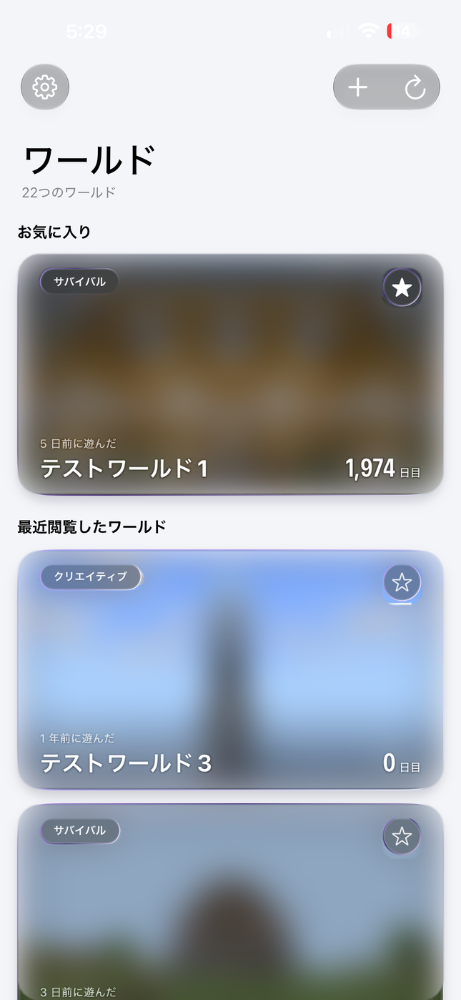
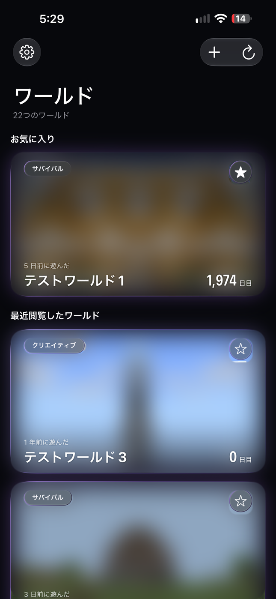
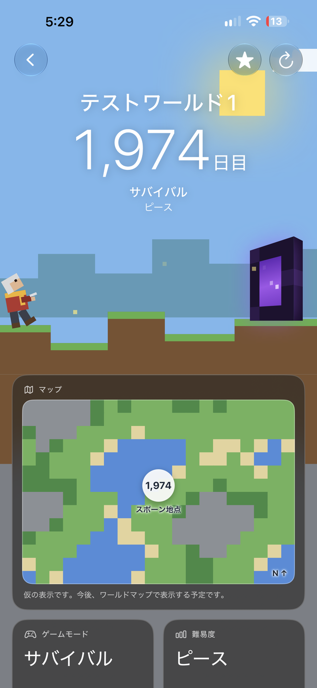
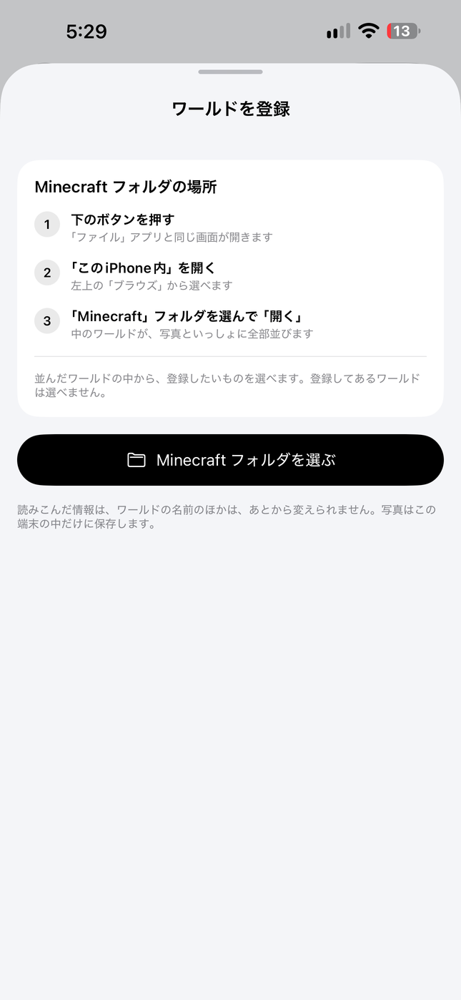

# Milestone

iPhone・iPad でマイクラ統合版を遊ぶ人が、自分のワールドをひと目で見て管理できるアプリ。

「Minecraft」フォルダを選ぶだけで、端末の中のワールドを写真つきでまとめて読みこみ、遊んだ日数・最後に遊んだ日・ゲームモードなどを、写真のカードで一覧にする。ワールドのファイルは**読むだけで書きかえない**ので、ワールドを壊す心配がない。

> NOT AN OFFICIAL MINECRAFT PRODUCT. NOT APPROVED BY OR ASSOCIATED WITH MOJANG OR MICROSOFT.
> このアプリは Minecraft の公式アプリではありません。Mojang および Microsoft とは関係ありません。

<!-- スクリーンショット：docs/screenshots/ に画像を置いて、下の表に並べる
| 一覧（ライト） | 一覧（ダーク） | ワールドの情報 | 登録 |
|---|---|---|---|
|  |  |  |  |
-->

## 1. 目的
- スマホ・タブレットのマイクラ統合版には、自分のワールドを一覧で見たり、どれだけ遊んだかを振り返ったりする場所がない。ワールドの書き出し（バックアップ）もゲームの中ではできず、端末が壊れると何年分ものワールドが消える不安がある。
- このアプリは、まず「自分のワールドを、安全に、ひと目で見られる」ことから始めて、バックアップなどの管理の機能へ広げていく土台にする。
- 対象は、iPhone・iPad で遊ぶ統合版のプレイヤー（子どもも多い）。操作は「フォルダを選ぶ」だけにして、ファイルの中身を知らなくても使えるようにした。

### SNS をやめて、ワールドの管理に絞った理由
最初は「マイクラ統合版向けの SNS（投稿・返信・いいね）＋ワールドの情報」として作り、フェーズ6まで SNS も動く状態にした。作りながら使ってみて、次の理由でワールドの管理に絞った。
- アプリの軸がぼやけていた。統合版向けの SNS には、すでにほかの SNS や Discord という代わりがあり、このアプリならではの価値はワールドの読みこみの側にあった。
- 子どもが多い SNS を安全に公開するには、通報・ブロック・見回りが欠かせず、作りきれない機能が残る。
- 機能を減らして、一つのことをていねいに作るほうが、使う人にとっても使いやすいと考えた。

SNS 込みの版は、タグ [`v1-sns`](../../tree/v1-sns) に残している。

## 2. 機能
### ログイン
- Google アカウントでログインする（初めてのログインでユーザーを自動で作る。入力は不要）
- 起動したときは、ロゴのロード画面を出してから、ログイン画面か一覧に切りかえる

### ワールドの一覧
- 登録したワールドを、16:9 の写真カードで並べる（お気に入り → 最近遊んだ・開いたワールド → 残り）
- カードには、ワールドの写真・名前・最後に遊んだ日（「3日前に遊んだ」）・ワールドの日数・ゲームモードを出す
- カードの縁の色で、遊んだ日数がひと目でわかる。サバイバルのワールドは、日数で決まるランクの素材の色（木は茶色 → 石は灰色 → 銅はオレンジ → 鉄は白っぽい銀 → 金は金色 → ダイヤは水色 → ネザライトは紫）。クリエイティブ・アドベンチャーなど、ランクのないワールドは、ゲームモードの色にする
- お気に入りを 1 つ選べる（星）
- 右上の ↻ で、全部のワールドを読みなおす（情報と写真が新しくなる）

### ワールドの登録
- 「Minecraft」フォルダを選ぶと、中のワールドを写真つきで全部並べる
- 登録したいものを選んで登録する（登録してあるワールドは選べない）
- 注意：Realms のワールドは Mojang のサーバーの上にあり、端末の Minecraft フォルダには入らないため、読みこめない。Realms の持ち主が「ワールドをダウンロード」で端末に写しを作れば、その写しは読みこめる（ダウンロードした時点の内容になる）

### ワールドの情報
- ワールドの日数・シード値（コピーできる）・スポーン地点・難易度・ルール・最後に遊んだ日時などを、天気アプリ風の画面で見る（背景はブロックの空と地面で、昼と夜はダークモードで切りかわる）
- 名前を変える（アプリでの名前を付ける。マイクラでの名前は残す）
- Minecraft フォルダから情報を読みなおす・ワールドを登録から消す（マイクラのワールド本体は消えない）

### 設定
- ログイン中のアカウント・ログアウト・公式ではない旨の表示

## 3. 技術のポイント
### 自作の NBT の読み込み
統合版のワールドの設定は `level.dat` に、NBT という形式（リトルエンディアン、先頭に 8 バイトのヘッダー）で入っている。ライブラリを使わず `NBTReader` を自作して読み、`LevelDatParser` で `World` に変換している。名前・シード値・ゲームモードなどの値は、Python で読んだ結果と一致することを確かめた。

### 「Minecraft」フォルダからのまとめての読み込み（`WorldFolderReader`）
- iOS のアプリは、ほかのアプリのファイルを自由には読めない（サンドボックス）。使う人に「ファイル」アプリの画面（`fileImporter`）でフォルダを選んでもらい、そのフォルダを読む許可（セキュリティスコープ）を受け取って読む。読み始めと読み終わり（`startAccessingSecurityScopedResource` / `stop…`）は必ず対にする。
- 選ばれたのが Minecraft・games・com.mojang・minecraftWorlds のどれでも、ワールドが並んでいるフォルダ（`minecraftWorlds`）を見つけて、中の `level.dat` があるフォルダだけを読む。読めないワールドがあっても、そこだけ飛ばす。
- 選んだ場所は「ブックマーク」として端末に覚えておき、2 回目からは選びなおさずに全部の更新ができる。

### ワールドの写真
- ワールドのフォルダの `screenshot_icon_数字` の中から、数字がいちばん大きいもの（マイクラのカメラで撮りなおすと数字が増える）を選び、なければ `world_icon` を使う。どちらもなければ、ゲームモードのアイコンを置いた板にする。
- 写真はサーバーに上げず、端末の中（Application Support）だけに保存する（`WorldPhotoStore`）。

### ランクの計算（`WorldRank`）
点 = ワールドの日数 × 倍率。チートが有効なら倍率を半分に、クリエイティブやチートを使ったことがあれば、さらに半分にする。点が 0・7・30・60・100・200・365 を超えるごとに、木から順にランクが上がる。Firestore には保存せず、毎回計算する。

### 設計
- SwiftUI と `@Observable` の ViewModel（MVVM）。データの読み書きは Repository に分け、プレビューでは偽物（Mock）に差し替えられる。
- フォルダは、`Models`・`Repositories`・`Services`（ファイルの読み込み・端末の中への保存）・`ViewModels`・`Views`（画面ごと）に分けている。

## 4. データ
### Firestore
| データ | 中身 | 読む・書く |
|---|---|---|
| `users/{uid}` | ID・名前（Google の名前）・お気に入りのワールドの ID | 本人だけ |
| `worlds/{worldId}` | level.dat から読んだワールドの情報・アプリでの名前・フォルダ名・持ち主の ID | 本人だけ |

- 同じワールドかどうかは、ワールドのフォルダ名で見分ける（level.dat の中に、ワールドごとの決まった ID がないため）。
- ワールドを読みなおしても、ID・登録した日時・アプリでの名前は残す。

### 端末の中だけに覚えるもの
| もの | 使いみち |
|---|---|
| Minecraft フォルダのブックマーク | 全部の更新で、選びなおさずに読む |
| ワールドの写真 | カードに表示する（サーバーには上げない） |
| ワールドの情報の画面を開いた日時 | 一覧の「最近閲覧したワールド」に使う |

## 5. 安全とルール
- Firestore のセキュリティルールで、ユーザーとワールドは本人だけが読み書きできるようにしている。ワールドを直すときは、直したあとの持ち主も自分であることを確かめ、持ち主を他人に書きかえられないようにしている。
- ワールドのファイルは読むだけで、書きかえない。
- Minecraft の利用ガイドラインに合わせて、アプリ名に「Minecraft」を使わず、公式のロゴ・ゲームの画像・テクスチャを使わない。「公式ではない」表示を、アプリの中（ログイン画面・設定）と README に載せている。ワールドの写真は使う人の端末の中だけで表示する。

## 6. 使う技術と理由
| 技術 | 使うところ |
|---|---|
| SwiftUI、@Observable（MVVM）、async/await | 画面と ViewModel |
| Firebase Authentication、GoogleSignIn | Google ログイン |
| Cloud Firestore | ユーザーとワールドの保存。セキュリティルールで読み書きできる人を決める |
| fileImporter、セキュリティスコープ、ブックマーク | 「ファイル」アプリから Minecraft フォルダを選んで読む |
| 自作の NBTReader | level.dat の読み込み |

Firebase を選んだのは、ログイン・データベース・読める人のルールが 1 つにそろい、サーバーづくりより iPhone アプリの画面と使いやすさに時間を使えるため。Firestore に保存しているので、ログインすれば別の iPhone・iPad でも、登録したワールドとお気に入りが見られる。

## 7. 開発での AI の使い方
Claude（Anthropic の AI）に、ほとんどのコードに関わってもらった。はじめは設計の相談・仕様とヒントをもらって自分で書き、AI にコードを確かめてもらう形で進め、途中からはコードの変更とコミットも AI に任せて、自分は中身を読んで確かめる形にした。そのため、後半のコミットには `Co-Authored-By: Claude` が付いている（GitHub のコミットの作者の欄に、Claude の名前とアイコンが並ぶ）。

## 8. 今後の予定
### ワールドの共有
ワールドの持ち主が、ワールドを .mcworld（中身は zip）にまとめて Firebase（Cloud Storage）に上げ、招待した友だちや家族がアプリから受け取って、自分のマイクラに読みこめるようにする。
- 持ち主がワールドを遊び進めたら、上げなおすだけで、受け取った人も新しいワールドに更新できる。
- 上げる・更新する・消すのは持ち主だけ、受け取れるのは招待された人だけにする（Cloud Storage と Firestore のセキュリティルールで守る）。
- 気をつけること：
  - ワールドは数十〜数百 MB になることがある。上げる前に大きさを見せ、通信量と保存の費用（Cloud Storage は従量課金）にも気を配る。
  - マルチプレイで遊んだワールドには、一緒に遊んだ人の持ち物・位置などのデータ（Xbox のアカウントの ID と結びついたもの）も入っている。上げる前に「何が相手に渡るか」を画面ではっきり見せる。

### 建物を 3D で見て、共有する
ワールドの中の一部（座標で範囲を決める）のブロックだけを読みこんで 3D で表示し、ほかの人と共有できるようにする。共有された建物は、アプリの中で回したり、1 段ずつ表示したりできるので、ほかの人の建物をまねして建てやすくなる。
- マイクラにも、建物を写して貼りつける仕組み（`/structure` や `/clone` のコマンド、ストラクチャーブロック）はあるが、どれもチートを有効にしないと使えない。チートを有効にすると実績が取れなくなるため、いちばん遊ばれているサバイバルでは使いにくい。このアプリなら、ワールドを読むだけなので、サバイバルのワールドにも影響しない。
- 作り方の見通し：ブロックは db/ の LevelDB のチャンク（サブチャンク）に入っているので、LevelDB と、その中のブロックの一覧（パレット）を読む。3D の表示は RealityKit か SceneKit を使う。共有は「ワールドの共有」と同じく Firebase に上げる。
- 気をつけること：マイクラ公式のテクスチャは使えないので、ブロックの見た目は、ブロックごとに決めた色や自作の絵で表す。

### ワールドの中のことを、マイクラを開かずに見る
db/ の LevelDB を読めるようにして、ワールドの中の様子を一覧で見られるようにする。
- **自分の持ち物と状態**：自分のプレイヤーのデータ（`~local_player`）から、持ち物・体力・経験値・今いる場所を出す。
- **最後に死んだ場所**：リカバリーコンパスが指す「最後に死んだ場所」の座標と次元（オーバーワールド・ネザー・エンド）を出す。持ち物を落としたまま、どこで死んだか思い出せないときに使う。
- **ネザーポータルのつながり**：db/ にあるポータルの記録から、オーバーワールドとネザーのポータルを地図に並べる。どれとどれがつながるかは、マイクラと同じルール（座標を 8 で割った場所の近くにある、いちばん近いポータル）で計算して、予想として線で結ぶ。
- **ペットや村人の一覧**：飼っている犬や猫、取引できる村人が、どこにいるかを一覧にする。迷子のペットを探すのにも使える。
- **アイテムの場所と数**：チェスト・樽・シュルカーボックスなどの中身と、地面に落ちているアイテムを読んで、「ダイヤはどこに何個あるか」を検索できるようにする。ワールド全体で何個持っているかの合計も出す。シュルカーボックスの中の中身（入れ子）やエンダーチェストの中身も数える。大きなワールドは読むのに時間がかかるので、一度読んだ結果を覚えておく。

### ホーム画面のウィジェット
最近遊んだワールドのカード（写真・日数・ランクの色）を、iPhone・iPad のホーム画面に出す（WidgetKit）。

### そのほか
- ワールドのバックアップ（.mcworld にまとめて保存する）
- ワールドの地図の表示と、チャンクの削除（重くなったワールドを軽くする。db/ の LevelDB を読む）
- 座標のメモ（地図の上にピンを刺す）
- iPad の画面の最適化

## 9. 動かし方
- iOS 27 以降。Xcode でプロジェクトを開いてビルドする。
- Firebase の設定ファイル（`GoogleService-Info.plist`）は GitHub に上げていない。動かすときは、自分の Firebase プロジェクトを作り、iOS アプリを追加して、ダウンロードした `GoogleService-Info.plist` を `Milestone/` フォルダに入れる。Authentication で Google ログインを、Firestore Database を有効にする。
- ワールドを読むには、iPhone・iPad にマイクラ統合版が入っていて、「ファイル」アプリの「この iPhone 内」に「Minecraft」フォルダが見える必要がある。

## メモ
- アプリ名の「Milestone（マイルストーン）」は、道ばたに立てた道しるべの石と、そこから広がった「節目・できごとの印」という意味。ワールドで遊んだ日数や節目を見返すアプリの中身に合わせた。
- 開発の流れ：フェーズ0〜6 で、要件定義・設計・ログイン・SNS（タイムライン・投稿・返信・いいね）・ワールドの登録と情報を作り、その後ワールドの管理に絞って、一覧の写真カード・フォルダからのまとめての読み込み・黒白基調のデザインに作りなおした。
